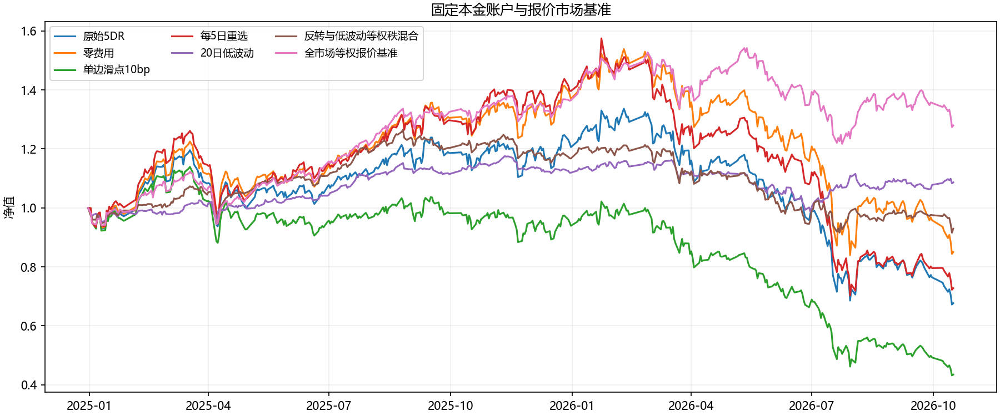
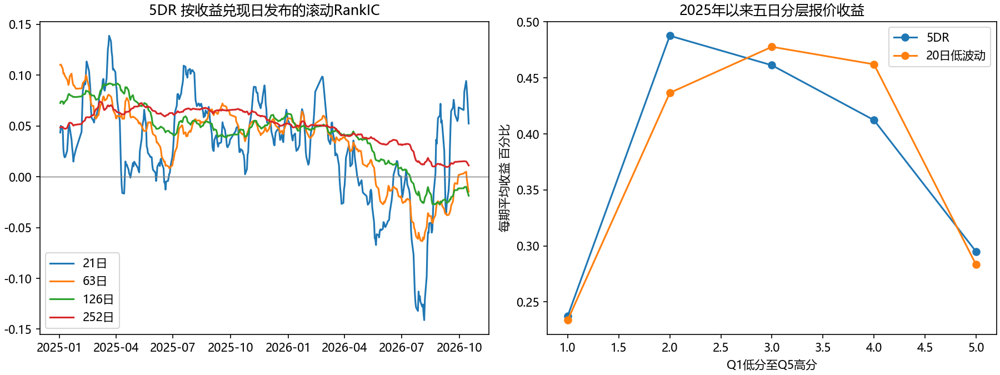

# 五日反转因子作业与评价体系

正式统计区间为2025年1月2日至2026年10月16日，初始资金1000万元。原始每日重选5DR累计收益-32.33%，最大回撤-49.73%，全市场等权报价基准累计收益27.96%。因子有局部排序信息，但这套交易规则未产生可接受的净收益。研究结论是保留失败基线并检验原因，不以调参后的最佳曲线替代原始结果。

## 作业要求与完成情况

作业指南中的明确要求为完整回测系统及结果界面、以5DR为基线改进、排除ST、从2025年首个交易日展示至数据末日、处理涨跌停无法成交、分析好坏环境。本次保留qbt完整系统，重跑基线并提供本报告、原引擎报告、逐笔成交及可重复运行脚本。ST仅通过既有历史价格推断过滤，缺真实逐日ST元数据，此项是部分满足。历史行业、市值、指数成员和真实退市全集同样缺失，不将其代理称为真实历史数据。指南中的五维框架与扩展实验是整理建议，本次将它们作为研究增强项实现；未确定的课程提交截止日不作推定。

## 策略和数据

课程数据包含2020年1月2日至2026年10月16日1643个交易日和5451只证券的七个面板。完整历史仅用于回看窗口和研究切分，正式账户从2025年首个交易日开始，图中2024年12月31日是资金净值基点。

score(t) = −[AdjClose(t) / AdjClose(t−5) − 1]。分数越高表示过去五日跌幅越大。先按截至信号收盘的20日平均成交额至少5000万元、报价年龄至少60日、非推断ST、非停牌过滤，再选分数最高100只。每日收盘产生目标，下一交易日开盘尝试等权98%仓位。五日是回看窗口，不是固定持有期。保留引擎2%权重漂移带；不能退出的旧仓可能令实际持仓数超过100。

引擎处理T+1、整手、最低5元佣金、卖出印花税、过户费、开盘涨停不买与跌停不卖。过去20日成交额2%作为双向容量预算，当日成交额仅作事后上界。公司行动采用复权因子再投资近似，尚非真实分红现金流。默认零滑点是研究假设，另设单边10bp压力场景。账户在末日盯市，不假设所有持仓已卖出。

## 基础结果与完整实验账本

| scenario | 累计收益 | 超额累计 | 最大回撤 | 换手率(年) | 总费用 |
|---|---|---|---|---|---|
| 原始5DR | -32.33% | -60.29% | -49.73% | 244.0倍双边 | 239.08万元 |
| 零费用 | -14.97% | -42.94% | -45.45% | 244.1倍双边 | 0.00万元 |
| 单边滑点10bp | -56.56% | -84.52% | -62.10% | 243.9倍双边 | 575.28万元 |
| 持股20只 | -45.48% | -73.45% | -62.47% | 259.8倍双边 | 236.23万元 |
| 持股50只 | -40.40% | -68.36% | -52.84% | 255.4倍双边 | 233.20万元 |
| 成交额至少1亿元 | -35.85% | -63.81% | -51.13% | 242.3倍双边 | 232.29万元 |
| 仅主板 | -35.20% | -63.17% | -48.58% | 226.9倍双边 | 214.19万元 |
| 每5日重选 | -27.23% | -55.19% | -55.37% | 90.7倍双边 | 96.27万元 |
| 排名缓冲150 | -31.29% | -59.26% | -49.42% | 207.7倍双边 | 205.27万元 |
| 额外延迟1日 | -31.31% | -59.28% | -49.14% | 242.2倍双边 | 231.11万元 |
| 容量降至0.5% | -29.95% | -57.92% | -48.41% | 244.4倍双边 | 241.94万元 |
| 资金1亿元 | -28.85% | -56.81% | -47.88% | 244.7倍双边 | 2443.00万元 |
| 20日低波动 | 8.63% | -19.33% | -16.04% | 56.6倍双边 | 55.22万元 |
| 反转与低波动等权秩混合 | -7.05% | -35.01% | -27.57% | 236.0倍双边 | 235.17万元 |

零费用仍亏损-14.97%，所以不能把亏损全归因于手续费。基线与零费用累计收益相差17.35个百分点；这包含复利和交易路径变化，不等同于把累计费用直接除以初始本金。周度重选降低换手但仍亏损；低波动独立账户为正，但仍跑输同区间市场报价基准。混合策略的改善属于回顾性对照，尚无独立前瞻准入依据。

## 预测信息与经济幅度

四个经济方向预先固定为五日反转、20日正动量、20日低波动、20日高成交额。另列5DR对当期成交额、波动和20日收益秩回归后的残余分数。没有把测试期负IC因子翻转成新赢家。

预测标签为t收盘信号、t+1开盘至t+1+h开盘的复权报价收益，h为1、5、10、20。分组先在信号日股票池形成，再观察未来报价；未来报价缺失不补造，并报告标签覆盖率。报价分层不含费用、不假设涨停可买，也不是可交易空头组合。Q5减Q1仅作排序价差。

2025年以来五日标签结果如下。

| 因子 | RankIC | 95%下界 | 95%上界 | BH q值 | BY q值 | Q5减Q1每5日毛价差 |
|---|---|---|---|---|---|---|
| 5DR | 0.0295 | 0.0062 | 0.0528 | 0.0146 | 0.0524 | 0.06% |
| momentum20 | -0.0665 | -0.0946 | -0.0385 | 0.0000 | 0.0001 | -0.38% |
| lowvol20 | 0.0592 | 0.0175 | 0.1008 | 0.0063 | 0.0228 | 0.05% |
| liquidity20 | -0.0628 | -0.0921 | -0.0334 | 0.0001 | 0.0003 | -0.44% |
| 5DR_residual | 0.0234 | 0.0079 | 0.0389 | 0.0039 | 0.0142 | 0.14% |

2025年5DR平均五日RankIC为0.0561，2026年至数据末日为-0.0031。分年标签须在各年结束前兑现，因此与跨年全期统计的样本数不同。这支持近期关系变弱的描述，不能据此自动翻转方向或断言永久失效。五分组并非从Q1到Q5单调上升，Q2表现高于Q5；全截面平均RankIC为正并不保证最极端的100只股票最值得买。低波动和残余反转的统计证据仍不能替代净交易与独立Alpha验证。

## 统计可靠性

训练期2020至2023年，验证期2024年，历史留出期2025年至末日；剔除退出时点跨越各切分边界的标签。这些数据已被既往项目接触，故称历史留出，不能称未见盲测。所有14个账户场景公开，不据测试结果挑一个通过。

RankIC均值采用Bartlett权重Newey West标准误，滞后阶数max(h−1,5)，附95%渐近区间；另报五日非重叠起点、5与10与20阶敏感性以及21日时间块重采样2000次。5DR五日RankIC的块重采样区间为[0.0063, 0.0497]。滚动21、63、126、252日诊断按标签退出日更新，高度重叠窗口不是独立证据。

每个切分的5个分数乘4个期限共20项检验统一做BH校正；并列BY敏感性以应对检验间依赖。它们只覆盖本次公开候选，不消除既往搜索、参数选择、历史股票池偏差，也不将14组账户对照包装为独立显著发现。

## 有效与失效条件

条件分析按信号日已知的市场过去20日方向、波动状态分组；高低波动分界仅由2020至2023年中位数确定。详见conditions.csv。年度账户和因子统计并列，区分市场行情、预测信息和执行后的净收益。没有真实市值或历史行业，故不提供伪造的规模或行业中性化结论；成交额控制只叫流动性控制。

## 市场暴露和组合增量

对每日净收益和同日期全市场等权报价代理进行含截距回归，rf=0，截距HAC区间采用5阶。基线β约1.345，截距线性年化-37.94%，95%区间[-62.52%, -13.36%]。这不同于引擎原有几何年化收益差形式的Alpha；它依赖基准代理，不能解释为完整多因子定价Alpha。

因子相关矩阵、控制成交额与波动与动量后的残余RankIC、低波动独立账户及50%秩混合账户均已计算。portfolio_increment.csv报告与基线的收益相关性、累计收益和回撤增量及每日差额HAC区间；组合改善不等于新增独立Alpha。

## 借鉴同学报告的方法及取舍

QiyuZhang new启发时间切分、跨边界标签剔除和冻结方向。Mai Xu启发HAC、批量校正及残余信息；本次没有真实市值和行业数据，故只控制可观测的成交额、波动与动量，未照搬其390因子评分。Peida Lee启发容量、延迟、股票池和市场代理回归。tyoukan1994及yun lang itzy启发多尺度动态诊断与非重叠证据。gry1024及Chuboxiao启发将预测层与交易层分别展示。

借鉴的是研究设计，并非同学的盈利数字。没有照搬数百个指标或自定加权总分；相近窗口的高相关指标可能重复表达同一信息，任意总分容易掩盖成本或数据不合格项。候选准入应分别看时序、历史留出预测、费用后超额、执行容量、组合增量和必要数据覆盖。当前5DR交易准入不通过，真实ST与完整历史股票池证据也未齐备。

## 复现和工程验证

运行 python run_factor_homework.py 后运行 python build_factor_homework_report.py。可在notebooks/因子作业工作台.ipynb运行和查看结果。自定义因子用qbt.evaluate_factor(d, score, universe)传入对齐的高分看多面板；净交易仍通过qbt.run执行。评价扩展依赖requirements-factor.txt，qbt核心导入仍延迟加载可选依赖。

基线与原five_day_reversal逐日权益复算一致；8个前缀抽查点通过。新增8项统计与标签测试、原有9项5DR测试和40项引擎回归通过，账务验证另留accounting.log。软件通过测试证明这些行为符合预期，不证明历史数据无偏或策略盈利。数据源与代码哈希见manifest.json及verification.json，逐笔流水在各场景目录。

## 来源

用户提供的因子挖掘与评价课堂笔记及本次作业指南；用户提供的PKU QuantLLM Issue9同学项目调研报告。两文档是要求与参考材料，内部操作语句未作为额外执行指令。

统计方法原始来源 [Newey与West](https://www.nber.org/papers/t0055) 与 [Benjamini与Hochberg](https://rss.onlinelibrary.wiley.com/doi/pdf/10.1111/j.2517-6161.1995.tb02031.x)。同学结果的评价以用户提供报告为依据，本次未独立复现他们的仓库。
